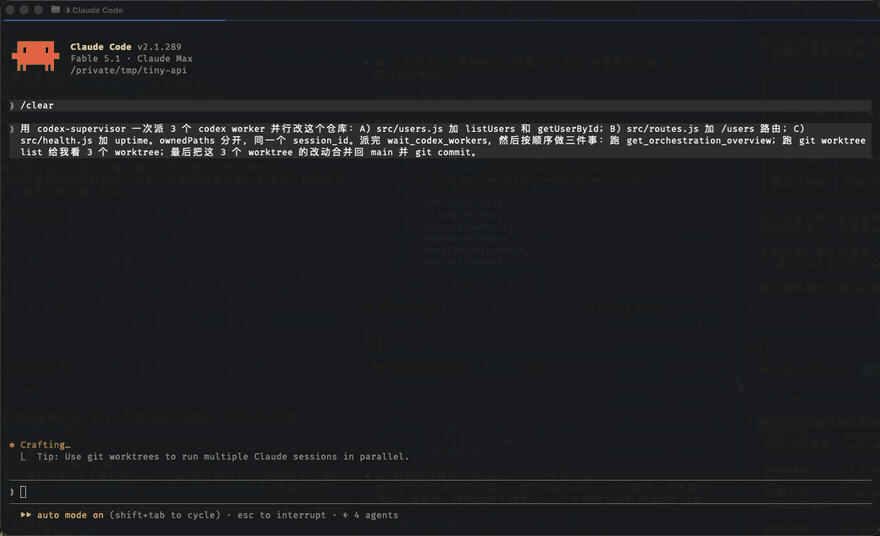

# codex-supervisor-mcp

English | [中文](README.md)

[](https://www.npmjs.com/package/codex-supervisor-mcp)
[](https://www.npmjs.com/package/codex-supervisor-mcp)
[](LICENSE)
[](https://github.com/zriyox/codex-supervisor-mcp/actions/workflows/ci.yml)
[](package.json)

Website [codex-supervisor.zriyo.com](https://codex-supervisor.zriyo.com) · for models [llms.txt](https://codex-supervisor.zriyo.com/llms.txt) · [reference](docs/reference.en.md)

Point several agents at one repository and they overwrite each other, nobody can say who changed what, and the main thread's context fills up with worker output.

codex-supervisor-mcp is an MCP server. A main thread (Claude Code, Codex, or any MCP client) uses it to run several Codex CLI workers at once: one Git worktree per worker, state in SQLite, and a web board to watch them. Dispatch and bookkeeping live on disk, not in the model's context.



*30 seconds, recorded live: three workers in their own worktrees in parallel, then the main thread collects three diffs and makes one commit.*

## What it solves

| Problem | What it does |
|---|---|
| Workers step on each other's files | One worktree per worker; `ownedPaths` is checked for conflicts before dispatch |
| Worker output floods the main thread | Events go to JSONL; the main thread reads a compressed overview (every worker in under 7000 bytes) |
| A restart or a new session loses the workers | One SQLite row per work, with its `thread_id`; `resume_codex_worker` rejoins the same Codex session |
| A failed run looks the same as a dead process | The state machine keeps `failed` and `lost` apart, and a failure carries its source and code |
| A worker says it is done and is not | Dispatch with `acceptance` commands; the supervisor runs them itself after the worker exits and refuses to land on failure |
| Changes sit on a local branch | `land_codex_worker` merges into the integration branch; `verify_delivery_push` proves the commit is on the remote |
| Worktrees pile up | Only verified, pushed and clean ones are marked SAFE, and nothing is removed until you say so. Branches and evidence stay |

A worker is a `codex exec` process and `model` is passed straight through. Keep the main thread on Claude, put the workers on DeepSeek or another provider, and the bills stay separate.

## Five minutes to a running batch

You need Node.js 22.13.0 or newer and the `codex` CLI on `PATH`. macOS, Linux and Windows all work.

```bash
npm install -g codex-supervisor-mcp
```

The install script puts the skill into every Claude Code and Codex it finds and registers the MCP server. Restart them afterwards. If nothing got registered (`--ignore-scripts`, for instance), run `codex-supervisor-setup`, or add it by hand:

```bash
claude mcp add -s user codex-supervisor -- npx -y codex-supervisor-mcp
codex mcp add codex-supervisor -- npx -y codex-supervisor-mcp
```

GUI clients such as Claude Desktop, Cursor and Windsurf need their MCP config edited by hand; the snippet is in the [reference](docs/reference.en.md#environment-variables). For the skill without the server: `npx skills add zriyox/codex-supervisor-mcp`.

Then say it in plain words in Claude Code:

> Fill in the unit tests for these three modules. Use codex-supervisor, three workers in parallel, call the session "unit tests".

The skill walks the main thread through this:

```
preflight_codex_worker   run a probe in the same environment first
create_codex_worker ×3   each with session_id, ownedPaths, goal
wait_codex_workers       60 seconds at most per call; call again until done
get_worker_result ×3     each worker's report, with the commands it ran and their exit codes
get_worker_diff ×3       what it actually changed
land_codex_worker ×3     reviewed; commit on its behalf and land
```

Workers never commit. Their changes stay on `codex/<taskId>` until the main thread has read the diff.

To watch them work, open the board:

```bash
codex-supervisor-web     # or: npx -p codex-supervisor-mcp codex-supervisor-web
```

Open `http://127.0.0.1:7877`. It shows each session's workers: status, the command running right now, changes and events. You can also ask a worker a question on the side; the answer comes from a read-only fork of its thread, so the work in progress is not interrupted. The board is read-only. It does not dispatch or cancel.

## How I use it

Anything that speaks MCP can be the main thread; this is just my way. I run two Claude Code sessions, one for documents and one for dispatch. A single session that writes the design and also watches the workers fills its context in two hours.

| Who | Where | Does what |
|---|---|---|
| Me | | Decide what to build, make the calls, read the reports |
| Planning session | The requirements and docs repository | Talk through the requirement, write the design, write one brief per block of work |
| Main-brain session | A worktree of the code repository | Read the brief, dispatch workers, check diffs, report to me. Writes no business code |
| Codex workers | Their own worktrees | One worker per independently verifiable feature package. No commit, no push |

One block of text passes between the two sessions, pasted into the main-brain session and handed over with `/goal`:

```text
[Role]        You are the main brain: dispatch workers, check results, update docs, report to me.
              You write no business code. Load the codex-supervisor skill first.
[Background]  Why this block exists, what the previous one left behind
[Read first]  Which sections of which documents, and which one wins when they disagree
[Do]          Follow the table in section N of the brief. Nothing outside the table
[Dispatch]    search_works first so nothing is dispatched twice; one session_id for the batch;
              parallel only when write sets are disjoint; the verify command goes in acceptance too;
              a worker's word is not enough, the diff you read is
[Red lines]   What not to change, push or read
[Report]      Tables first, then stop and wait for me
```

## Tools

39 of them. Arguments and edge cases are in the [reference](docs/reference.en.md#tools).

| Stage | Tool | What it does |
|---|---|---|
| Before dispatch | `check_acceptance` | Runs the acceptance commands for real, to check the commands themselves |
| | `preflight_codex_worker` / `get_worker_preflight` | Starts a short probe in the target worker's environment, then reads its result |
| Dispatch | `create_codex_worker` | Dispatches one worker. `ownedPaths` and `goal` are required |
| | `create_codex_followup_worker` | A new session that builds on a parent task's work |
| | `resume_codex_worker` | Continues the same Codex session, optionally rebased onto the new head first |
| | `cancel_codex_worker` | Stops a worker |
| Tracking | `overview_delta` | The default polling call; returns only what changed since the last cursor |
| | `check_workers` | Reports newly finished and broken workers; a dead first run is recovered once |
| | `wait_codex_workers` | Waits for a result, 60 seconds at most per call |
| | `get_orchestration_overview` / `list_codex_workers` | The status table for every worker |
| | `get_codex_worker_status` / `get_codex_worker_events` | One worker's status detail and raw events |
| Collecting | `get_worker_result` / `get_worker_summary` | The worker's report, long and one-paragraph |
| | `get_worker_diff` | The actual changes, paged by file and hunk |
| | `get_worker_goal` | The dispatched goal and the native Codex goal's usage |
| | `ask_codex_worker` | Asks the worker a side question. Read-only; its thread is untouched |
| | `land_codex_worker` | Commits on the worker's behalf and cherry-picks onto the integration branch; refuses if acceptance failed |
| Delivery | `verify_delivery_push` | Proves the landed commit is on the remote. It verifies; it never pushes for you |
| | `cleanup_plan` / `apply_cleanup` / `cleanup_history` | Sorts worktrees into SAFE / REVIEW / BLOCKED and removes only the SAFE items you pick |
| Sessions | `get_session_works` / `search_works` | Finds a batch again, or searches history by substring |
| | `describe_session` | Records a batch's title, objective, default acceptance and approval state |
| Facts | `search_worker_facts` / `get_fact` | Looks up verified facts and their versions |
| | `promote_worker_fact` / `revoke_worker_fact` | The main thread promotes a candidate fact to verified, or revokes one |
| | `get_context_snapshot_meta` | What context a worker was given when it started |
| | `get_worker_evidence` / `get_artifact` | The evidence index and a single artifact |
| Review | `create_independent_verifier` | Starts a read-only, offline verifier to check the work again |
| | `record_independent_finding` / `resolve_independent_finding` / `get_independent_review` | Records the verdict, records how it was resolved, reads the whole trail |
| Other | `check_for_update` | Asks the registry for a newer version |

## How this differs from Claude Code subagents

A subagent can open its own worktree too, so file isolation is not the difference. The model and the process are.

| | Claude Code subagent | codex-supervisor worker |
|---|---|---|
| Which models | Claude only | Anything the Codex CLI has a provider for |
| Who does the work | Claude Code itself | A separate `codex exec` process |
| Two workers writing one file | No path declaration | `ownedPaths` overlap is checked before dispatch and rejected |
| The main thread dies | The work cannot be collected | Workers and acceptance run to the end; a new window collects them by `session_id` |
| Who can drive it | Claude Code only | Any MCP client |
| Seeing the process | Only the conclusion it returns | Raw JSONL and the web board |

## Configuration and state

Everything lives under `~/.codex-supervisor/`: `data/supervisor.sqlite` is the ledger, `data/runs/<taskId>.jsonl` is Codex's raw output, and `worktrees/<taskId>/` holds each worker's checkout.

| Variable | Default | What it does |
|---|---|---|
| `SUPERVISOR_HOME` | `~/.codex-supervisor` | State root. The MCP server and the board must point at the same one |
| `CODEX_BIN` | `codex` | Path to the Codex CLI. GUI clients often lack it on `PATH` |
| `SUPERVISOR_WEB_PORT` | `7877` | Board port |
| `CODEX_SUPERVISOR_NO_AUTO_UPDATE` | unset | `1` turns off background updates and only notifies |

The remaining variables, the six worker states and the cache directories the sandbox opens by default are in the [reference](docs/reference.en.md).

Updates take care of themselves. At start the server asks the registry in the background and, if there is a newer version, a detached process runs `npm i -g`. The running session is untouched and the next one starts on the new version. This only applies to a global install.

Uninstall:

```bash
npm uninstall -g codex-supervisor-mcp
claude mcp remove -s user codex-supervisor
codex mcp remove codex-supervisor
rm -rf ~/.claude/skills/codex-supervisor ~/.agents/skills/codex-supervisor ~/.codex/skills/codex-supervisor ~/.codex-supervisor
```

## Troubleshooting

| Symptom | Cause | Fix |
|---|---|---|
| Missing from `claude mcp list` | The install did not run `postinstall` | `codex-supervisor-setup` |
| Worker `failed` at once, `spawn codex ENOENT` | No codex on the process `PATH` | Set `CODEX_BIN` |
| `codex only resolved to a shell shim` | Windows found only the `.cmd`; the package entry is gone | Reinstall `@openai/codex`, or point `CODEX_BIN` at `codex.js` |
| `Cannot find module 'node:sqlite'` | Node older than 22.13.0 | Upgrade Node |
| Worker is `lost` | The worker or its run process was killed | Read the events, then `resume_codex_worker` |
| `git add` fails with `index.lock: Operation not permitted` | The sandbox makes `.git` read-only. That is the intended boundary | Let `land_codex_worker` commit with `commitMessage` |
| `ownedPaths overlap with active worker(s)` | Two workers claimed the same paths | Split the work differently, or cancel the one holding them |
| The board is empty | The board and the MCP server use different `SUPERVISOR_HOME` | Point both at the same directory |
| `port 7877 ... is already in use` | A board is already running | Open that one, or change `SUPERVISOR_WEB_PORT` |

## Known limitations

- A worktree is cut from a commit. Uncommitted changes in your checkout are not in it.
- Only the working directory is isolated. Temp directories, databases and ports are shared.
- The guard blocks direct file writes, but it is not a filesystem sandbox. A script you allowed can have side effects outside its declared paths; the diff check before landing is what catches them.
- Acceptance checks what you wrote in `acceptance` and nothing else. The rest is the main thread reading the diff.
- The client's MCP tool timeout is a hard wall, so one `wait_codex_workers` call cannot wait to the end. Call it again.
- `search_works` is substring matching, which is enough for a few hundred works. Vector search is not planned.

## Development

```bash
npm install
npm test               # fake-codex replay, under a minute
npm run test:real      # real codex CLI end to end; needs a logged-in codex
npm run web:dev        # board development, /api proxied to 7877
```

CI runs on Ubuntu, macOS and Windows, plus a Node 22.13.0 job that pins the lower bound of `engines`.

To contribute, read [CONTRIBUTING.en.md](CONTRIBUTING.en.md). Security reports go through the [private channel](https://github.com/zriyox/codex-supervisor-mcp/security/advisories/new); see [SECURITY.md](SECURITY.md).

## License

MIT
