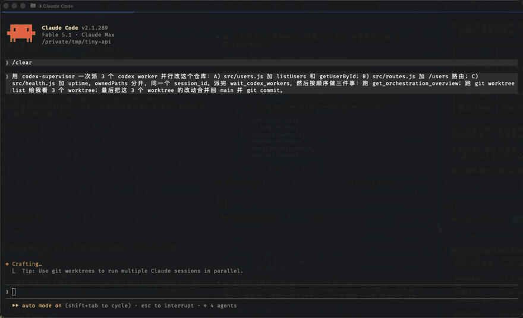

# codex-supervisor-mcp

[English](README.en.md) | 中文

[](https://www.npmjs.com/package/codex-supervisor-mcp)
[](https://www.npmjs.com/package/codex-supervisor-mcp)
[](LICENSE)
[](https://github.com/zriyox/codex-supervisor-mcp/actions/workflows/ci.yml)
[](package.json)

官网 [codex-supervisor.zriyo.com](https://codex-supervisor.zriyo.com) · 给模型读的 [llms.txt](https://codex-supervisor.zriyo.com/llms.txt) · [参考手册](docs/reference.md)

让几个 agent 同时改一个仓库，结果是互相覆盖，没人说得清谁改了什么，主线程的上下文还被 worker 的输出塞满。

codex-supervisor-mcp 是一个 MCP server。主线程（Claude Code、Codex 或任何 MCP 客户端）用它同时指挥多个 Codex CLI worker：一个 worker 一个 Git worktree，状态写进 SQLite，另有一个网页看板。派单和记账都在磁盘上，不占模型上下文。



*30 秒真跑：派 3 个 worker，各自 worktree 并行，主线程收 3 份 diff 合成一次 commit。*

> **从 0.x 升级到 1.x**：工具从 39 个收成 14 个，名字和参数都换了，旧名不留别名。升级前先把在跑的 worker 收完，升级后重开会话让新 skill 生效。对照表在[参考手册](docs/reference.md)，变更说明在 [1.0.0 release](https://github.com/zriyox/codex-supervisor-mcp/releases/tag/v1.0.0)。

## 解决什么

| 问题 | 做法 |
|---|---|
| 几个 worker 互相踩文件 | 一个 worker 一个 worktree，`owned_paths` 在派单前查冲突 |
| worker 的输出塞爆主线程 | 事件写 JSONL，主线程只读压缩过的概览（全部 worker 不超过 7000 字节） |
| 重启或换会话后接不上 | 每个 work 一行 SQLite，带 `thread_id`；`resume_worker` 接回同一个 Codex 会话 |
| 分不清跑失败还是进程没了 | 状态机把 `failed` 和 `lost` 分开，失败带来源和错误码 |
| worker 说做完了其实没有 | 派单带 `acceptance` 验收命令，supervisor 在 worker 退出后自己跑，不过就拒绝合入 |
| 改动留在本地没上线 | `land_worker` 合回主分支，`verify_push` 核对远端真有这笔提交 |
| worktree 越堆越多 | 已合入或没有改动的在轮询时自动清；没合入的留 7 天，删之前先把未提交的改动存进它的分支。分支和证据不删 |

worker 默认跑 `codex exec`，`model` 透传。主线程留在 Claude，worker 挂 DeepSeek 或别的 provider，账单分开算。

worker 也可以是 Claude Code：`create_worker` 带 `runner: "claude"`。它没有系统级沙箱，所以只能在 git worktree 或只读模式下跑，也不支持旁问（`ask_worker`）；其余派单、验收、续跑、合入、清理都一样。想接别的 CLI，看 [docs/runner.md](docs/runner.md)。

## 五分钟跑起来

要 Node.js 22.13.0 以上，`codex` CLI 在 `PATH` 里。macOS、Linux、Windows 都行。

```bash
npm install -g codex-supervisor-mcp
```

安装脚本会给检测到的 Claude Code 和 Codex 装 skill、注册 MCP，装完重启它们。没注册上（比如用了 `--ignore-scripts`）就跑一次 `codex-supervisor-setup`，或者手动加：

```bash
claude mcp add -s user codex-supervisor -- npx -y codex-supervisor-mcp
codex mcp add codex-supervisor -- npx -y codex-supervisor-mcp
```

Claude Desktop、Cursor、Windsurf 这类 GUI 客户端要自己改 MCP 配置，写法在[参考手册](docs/reference.md#环境变量)。只要 skill 不要 MCP：`npx skills add zriyox/codex-supervisor-mcp`。

然后在 Claude Code 里说人话：

> 把这三个模块的单测补齐，用 codex-supervisor 分三路并行跑，session 叫「补单测」。

skill 会带着主线程走完这几步：

```
preflight_worker     先在同样的环境里跑一遍 probe
create_worker ×3     每路带 session、owned_paths、goal
wait_workers         一次最多等 60 秒，没完接着等
get_worker ×3        每路的汇报，带它真跑过的命令和退出码
get_worker_diff ×3   它实际改了什么
land_worker ×3       核过了，代它提交并合入
```

worker 自己不提交。它的改动留在 `worker/<taskId>` 分支，等主线程看过 diff 再合。

想看着它们跑，开看板：

```bash
codex-supervisor-web     # 或 npx -p codex-supervisor-mcp codex-supervisor-web
```

打开 `http://127.0.0.1:7877`。按 session 看每路 worker 的状态、正在跑的命令、改动和事件，还能旁问：从 worker 的线程 fork 一个只读会话来答，不打断它手上的活。看板只看，不派单也不取消。

## 我自己怎么用

能连 MCP 的都能当主线程，下面只是我的用法。我开两个 Claude Code 会话，一个只管文档，一个只管派活。合成一个的话，又写详设又盯 worker，上下文两小时就满。

| 谁 | 开在哪 | 管什么 |
|---|---|---|
| 我 | | 定需求，拍板，看汇报 |
| 规划会话 | 需求和文档仓 | 聊需求，写详设，每块活写一份任务书 |
| 主脑会话 | 代码仓的一个 worktree | 读任务书，派 worker，核 diff，向我汇报。不写业务代码 |
| Codex worker | 各自的 worktree | 一个 worker 做一个能独立验收的功能包。不 commit、不 push |

两个会话之间只传一段文字，粘进主脑会话用 `/goal` 接上：

```text
【角色】  你是主脑：派 worker，核结果，更新文档，向我汇报。不写业务代码。先加载 codex-supervisor skill。
【背景】  这一块为什么做，上一块留下了什么
【先读】  哪几份文档的哪几节，说法冲突时以哪份为准
【做什么】照任务书第几节那张表做，表里没有的不做
【派活】  先 find_works 查重；整批同一个 session.id；
          写入范围不重叠才并行；验证命令同时填 acceptance；
          worker 说过了不算，你看到 diff 才算
【红线】  不改什么，不推什么，不读什么
【汇报】  中文，表格优先，报完停下来等我
```

## 工具

默认 14 个。入参和边界见[参考手册](docs/reference.md#工具)。

| 阶段 | 工具 | 干什么 |
|---|---|---|
| 派单前 | `preflight_worker` | 用和目标 worker 相同的环境起一个短 probe，或者先把验收命令真跑一遍 |
| 派单 | `create_worker` | 派一路。带 `followup_of` 就是接着另一路的成果干 |
| | `resume_worker` | 同一个会话继续跑，可先 rebase 到主线新头 |
| | `cancel_worker` | 终止一路 |
| 盯进度 | `poll_workers` | 不带 cursor 给全表；带 cursor 只给上次之后的变化，顺带恢复死掉的第一轮、清掉可清的 worktree |
| | `wait_workers` | 等到有结果，单次最多 60 秒 |
| 收活 | `get_worker` | 读一路：摘要、汇报、状态、事件、goal，要哪块取哪块 |
| | `get_worker_diff` | 实际改动，按文件和 hunk 分页 |
| | `ask_worker` | 旁路问它一句，只读，不动它的线程 |
| 交付 | `land_worker` | 代提交并 cherry-pick 到集成分支，验收没过就拒 |
| | `verify_push` | 证明合入的提交已经在远端。只验证，不替你 push |
| | `cleanup` | 看某个 worktree 为什么还在，或立刻清掉。平时是自动清的 |
| 批次 | `find_works` | 找回一批活，或按关键字搜历史 |
| | `describe_session` | 给一批活记标题、目标、默认验收和审批状态 |

另有 3 个默认不注册，设 `AGENT_SUPERVISOR_TOOLS=all` 才出现：`facts`（已验证事实的台账）、`review`（起一个只读 verifier 独立复核）、`get_artifact`（读留存的证据）。日常派活用不到，不注册能省下每个会话的上下文。

## 和 Claude Code 的 subagent 有什么区别

subagent 自己也能开 worktree，所以文件隔离不算差别。差别在模型和进程。

| | Claude Code subagent | codex-supervisor worker |
|---|---|---|
| 能跑什么模型 | 只能选 Claude | Codex CLI 配了 provider 的都行 |
| 干活的是谁 | Claude Code 自己 | 独立的 `codex exec` 进程 |
| 两路写同一个文件 | 没有路径声明 | 派单前查 `owned_paths` 交集，重叠直接拒 |
| 主线程挂了 | 收不回来 | worker 和验收照常跑完，新窗口用 `find_works` 找回 |
| 谁能驱动 | 只有 Claude Code | 任何 MCP 客户端 |
| 看过程 | 只有它返回的结论 | 原始 JSONL 和网页看板 |

## 配置和状态

状态都在 `~/.codex-supervisor/`：`data/supervisor.sqlite` 是台账，`data/runs/<taskId>.jsonl` 是 Codex 的原始输出，`worktrees/<taskId>/` 是各路的工作区。

| 变量 | 默认 | 作用 |
|---|---|---|
| `SUPERVISOR_HOME` | `~/.codex-supervisor` | 状态根目录。MCP 和看板要指同一个 |
| `CODEX_BIN` | `codex` | Codex CLI 路径。GUI 客户端的 `PATH` 里常常没有它 |
| `SUPERVISOR_WEB_PORT` | `7877` | 看板端口 |
| `AGENT_SUPERVISOR_NO_AUTO_UPDATE` | 未设 | `1` 关掉后台自动更新，只提醒 |

其余变量、worker 的六种状态、沙箱默认放开哪些缓存目录，都在[参考手册](docs/reference.md)。

更新不用管。server 启动时后台查一次 registry，有新版就另起进程 `npm i -g`，正在跑的会话不受影响，下一个新会话就是新版。只对全局安装的那份生效。

卸载：

```bash
npm uninstall -g codex-supervisor-mcp
claude mcp remove -s user codex-supervisor
codex mcp remove codex-supervisor
rm -rf ~/.claude/skills/codex-supervisor ~/.agents/skills/codex-supervisor ~/.codex/skills/codex-supervisor ~/.codex-supervisor
```

## 排查

| 症状 | 原因 | 处理 |
|---|---|---|
| `claude mcp list` 里没有 | 安装时没跑 `postinstall` | `codex-supervisor-setup` |
| worker 一起来就 `failed`，`spawn codex ENOENT` | 进程 `PATH` 里没有 codex | 设 `CODEX_BIN` |
| `codex only resolved to a shell shim` | Windows 只找到 `.cmd`，包入口没了 | 重装 `@openai/codex`，或 `CODEX_BIN` 指到 `codex.js` |
| `Cannot find module 'node:sqlite'` | Node 低于 22.13.0 | 升 Node |
| worker `lost` | worker 或它的运行进程被杀了 | 查事件，`resume_worker` 接回 |
| worker `timed_out` | 时间预算用完被停掉 | 看已有改动；单轮超时 `resume_worker`，总预算用完用 `followup_of` 带新 `limits` 接续 |
| `git add` 报 `index.lock: Operation not permitted` | 沙箱把 `.git` 设成只读，这是正常边界 | 让 `land_worker` 带 `commit_message` 代提交 |
| `owned_paths overlap with active worker(s)` | 两路认领了同一片路径 | 改拆法，或取消占着的那路 |
| 看板是空的 | 看板和 MCP 的 `SUPERVISOR_HOME` 不一样 | 两边指同一个目录 |
| `port 7877 ... is already in use` | 已经有一个看板在跑 | 直接开它，或换 `SUPERVISOR_WEB_PORT` |

## 已知限制

- worktree 从一个提交切出来，你工作区里没 commit 的东西不在里面。
- 只隔离工作目录。临时目录、数据库、端口是共用的。
- 守卫拦直接写文件，但它不是文件沙箱。你声明放行的脚本可以有清单外的副作用，要靠 land 前的 diff 检查兜住。
- `acceptance` 里写了什么就查什么，没写的不会替你查。剩下的靠主线程看 diff。
- 客户端的 MCP 超时是硬墙，一次 `wait_workers` 等不到底，只能反复调。
- `find_works` 是子串匹配，几百条够用。向量检索不打算做。

## 开发

```bash
npm install
npm test               # fake-codex 回放，不到一分钟
npm run test:real      # 真 codex CLI 端到端，要先登录
npm run web:dev        # 看板开发，/api 代理到 7877
```

CI 跑 Ubuntu、macOS、Windows，外加一个 Node 22.13.0 的 job 卡住 `engines` 下界。

贡献看 [CONTRIBUTING.md](CONTRIBUTING.md)。安全问题走[私密通道](https://github.com/zriyox/codex-supervisor-mcp/security/advisories/new)，见 [SECURITY.md](SECURITY.md)。

## License

MIT
